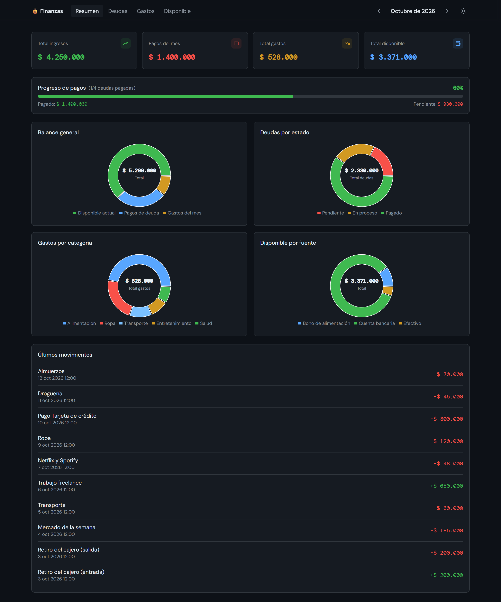
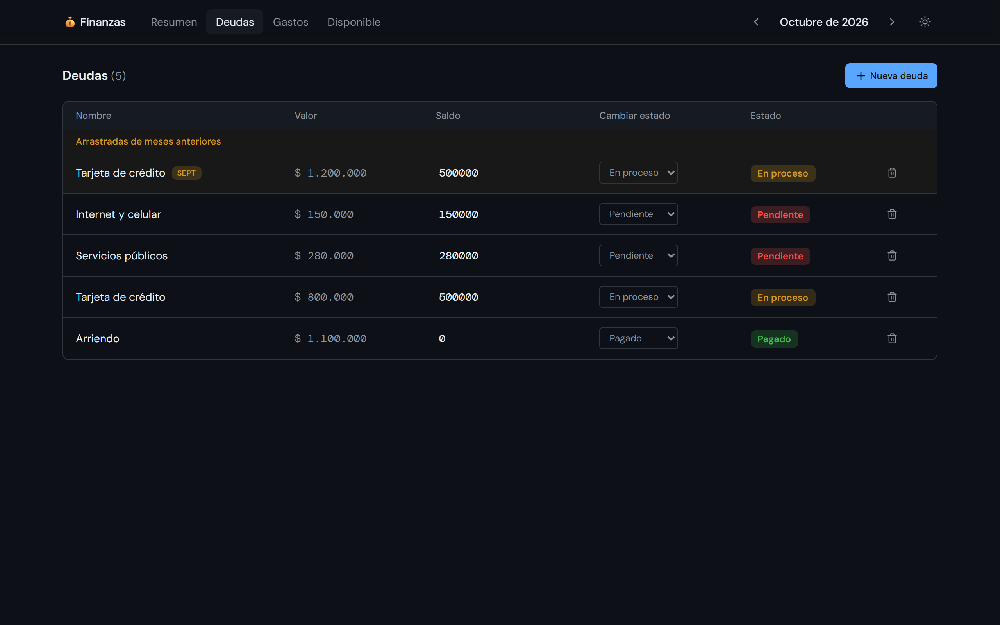
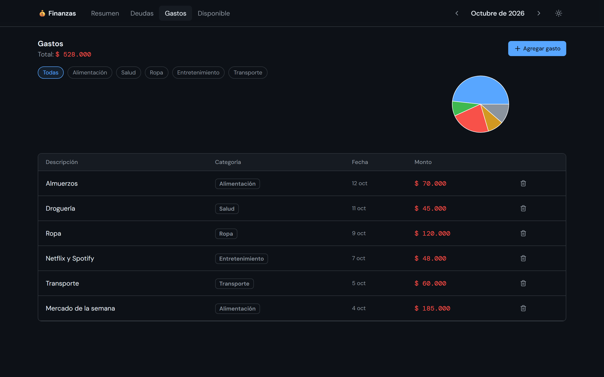
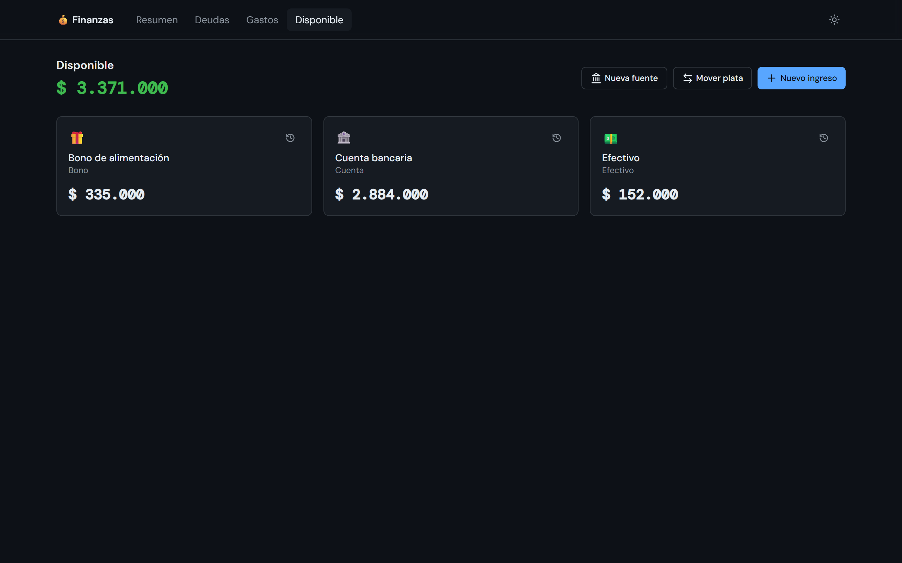
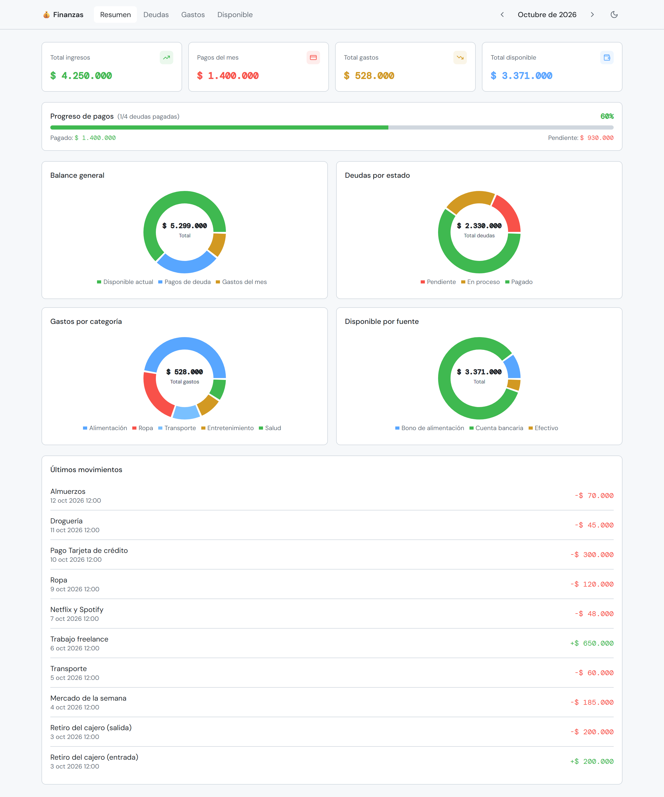
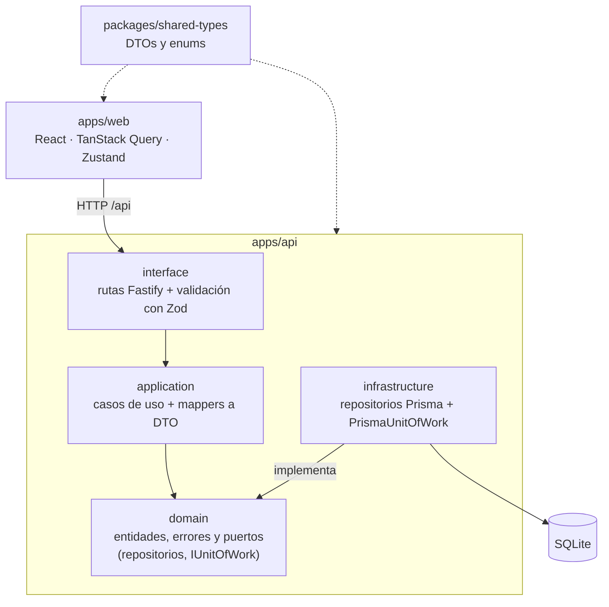

# Finanzas Personales

[](https://github.com/SrNe0/finanzas-app/actions/workflows/ci.yml)
[](https://github.com/SrNe0/finanzas-app/releases)
[](LICENSE)


App web de finanzas personales para llevar las **deudas** (con abonos y arrastre entre meses), los **gastos** por categoría y el **dinero disponible** repartido en varias fuentes (cuenta, efectivo, bonos). Los montos se manejan en pesos colombianos (COP, enteros sin decimales) y las fechas en zona horaria America/Bogota.

> **English summary:** a local-first personal finance app (debts with partial payments and month-to-month carry-over, expenses by category, and money across several sources). Full-stack TypeScript monorepo: React + Vite on the front end, Fastify + Prisma + SQLite on the back end, organised in Clean Architecture layers, with transactional use cases, over 230 automated tests and CI on every pull request. Amounts are integer Colombian pesos and dates follow the America/Bogota time zone.



<table>
  <tr>
    <td width="50%"></td>
    <td width="50%"></td>
  </tr>
  <tr>
    <td width="50%"></td>
    <td width="50%"></td>
  </tr>
</table>

Las capturas usan los datos ficticios de `pnpm db:seed:demo`.

> **Uso local:** la app no tiene autenticación y guarda todo en una base SQLite en tu equipo. La API solo escucha en `127.0.0.1`. No la expongas a internet ni a una red que no sea de confianza.

## Qué hace

- **Resumen**: métricas mensuales (ingresos, gastos, pagos, disponible), progreso de pago de deudas, cuatro gráficas de donut (balance general, deudas por estado, gastos por categoría, disponible por fuente) y los últimos movimientos.
- **Deudas**: deudas del mes con arrastre de las pendientes de meses anteriores, pagos parciales o totales desde cualquier fuente, y estados (Pendiente / En proceso / Pagado) que siempre son coherentes con el saldo. Al eliminar una deuda se devuelven a las fuentes los abonos registrados.
- **Gastos**: registro con categorías, con o sin fuente (si la tiene, la descuenta), filtros por categoría y gráfico de distribución. Al eliminar un gasto se devuelve el monto a su fuente.
- **Disponible**: fuentes de dinero (cuenta, efectivo, bono, otro), ingresos, transferencias entre fuentes e historial de movimientos de cada una.
- **Tema** oscuro y claro, y avisos claros con opción de reintentar cuando algo falla.

## Inicio rápido

Requisitos: **Node.js 22+** y **pnpm 11** (el repo declara la versión en `packageManager`; con Corepack basta `corepack enable`).

```bash
pnpm install       # instala y crea apps/api/.env a partir de apps/api/.env.example
pnpm db:migrate    # crea la base SQLite, aplica las migraciones y carga las fuentes iniciales
pnpm db:seed:demo  # (opcional) carga datos ficticios para explorar la app
pnpm dev           # API en http://localhost:3001 y web en http://localhost:5173
```

`pnpm db:seed:demo` solo funciona sobre una base sin datos: se niega a ejecutarse si ya hay deudas, gastos o movimientos, para no mezclarlos con datos reales.

### Configuración

- `DATABASE_URL` (en `apps/api/.env`, que no se versiona): URL de la base. Por defecto `file:../../data/finanzas.db`, relativa a `apps/api/prisma`, es decir, `apps/data/finanzas.db`.
- `PORT`: puerto de la API (por defecto 3001). `WEB_PORT` y `API_URL`: puerto de la web y dirección de la API a la que apunta su proxy (por defecto 5173 y `http://127.0.0.1:3001`). Sirven para levantar una segunda instancia con otra base sin tocar la principal.

### Scripts

| Comando | Descripción |
|---|---|
| `pnpm dev` | Arranca API y web en paralelo |
| `pnpm build` | Compila ambas apps |
| `pnpm lint` | Revisa el código con ESLint |
| `pnpm typecheck` | Revisa los tipos de la API (incluidos sus tests) y de la web |
| `pnpm format` / `pnpm format:check` | Formatea el código con Prettier / comprueba el formato |
| `pnpm --filter api test` | Tests de la API (Vitest) |
| `pnpm --filter web test` | Tests de la web (Vitest + Testing Library) |
| `pnpm db:migrate` | Migra la base de datos (incluye el seed inicial) |
| `pnpm db:seed` / `pnpm db:seed:demo` | Fuentes iniciales / datos de demostración |
| `pnpm db:studio` | Abre Prisma Studio |

## Arquitectura

Monorepo con pnpm workspaces:

```
finanzas-app/
  apps/
    api/            Backend: Fastify + TypeScript + Prisma (SQLite)
    web/            Frontend: React 18 + Vite + TanStack Query + Zustand + Tailwind + shadcn/ui
    data/           Base de datos SQLite local (no versionada)
  packages/
    shared-types/   DTOs y enums compartidos entre API y web
  docs/capturas/    Capturas de pantalla del README
```

El backend sigue **Clean Architecture**: las dependencias apuntan hacia el dominio.



- `domain` y `application` no pueden importar de `infrastructure`, `interface` ni de Prisma: lo comprueba ESLint (`no-restricted-imports`).
- El frontend se organiza por *features* (`resumen`, `deudas`, `gastos`, `disponible`) con su API, hooks y componentes.

## Decisiones técnicas

- **Operaciones atómicas.** Pagar una deuda, registrar o eliminar un gasto, transferir entre fuentes, etc. tocan varias tablas. Un puerto `IUnitOfWork` (en `domain`) ejecuta cada caso de uso dentro de una transacción de Prisma, de modo que un fallo a mitad de camino no deja saldos ni movimientos a medias. Hay tests de *rollback* que fuerzan el fallo.
- **Integridad del dinero.** Cada movimiento de un gasto o de un pago queda enlazado a su origen, así que eliminar un gasto o una deuda puede devolver el dinero exacto a la fuente correspondiente. Los montos son enteros y las entidades rechazan montos inválidos.
- **Reglas en el dominio.** El estado de una deuda se deriva de su saldo (pagada ⇔ saldo 0, pendiente ⇔ nada abonado) y las entidades impiden los estados incoherentes, en vez de confiar en la interfaz.
- **Fechas en Bogotá.** Las fechas se guardan en UTC, pero los meses se calculan con el desfase fijo de Bogotá (UTC-5, sin horario de verano). Un gasto hecho a las 9 p. m. del día 31 cuenta en su mes y no en el siguiente. Los tests de fechas no dependen de la zona horaria de la máquina.
- **Estrategia de pruebas.** Más de 230 tests: unitarios de las entidades, casos de uso con repositorios en memoria, integración de las rutas con `fastify.inject()` contra una SQLite temporal con las migraciones reales, y pruebas de la web con Testing Library. Los arreglos se escribieron primero como un test que reproduce el fallo.
- **Calidad automatizada.** GitHub Actions ejecuta lint, formato, tipos, tests y build en cada PR; la rama `main` está protegida y exige que el CI pase. Los commits siguen Conventional Commits y cada cambio entra por un PR enlazado a su issue.
- **Seguridad por diseño.** Al ser una app local sin autenticación, la API solo escucha en `127.0.0.1` y CORS admite únicamente el origen de Vite.

## Stack

| Capa | Tecnología |
|---|---|
| Backend | Node.js, Fastify, TypeScript (estricto), Zod |
| Datos | Prisma + SQLite |
| Frontend | React 18, Vite, TanStack Query v5, Zustand, React Hook Form |
| UI | Tailwind CSS v3, shadcn/ui (Radix), Recharts |
| Pruebas | Vitest, Testing Library |
| Calidad | ESLint, Prettier, GitHub Actions |

## Roadmap

El trabajo se organizó en fases; el detalle de cada tarea está en los [milestones](https://github.com/SrNe0/finanzas-app/milestones) y los [issues](https://github.com/SrNe0/finanzas-app/issues).

| Fase | Objetivo | Estado |
|---|---|---|
| [1 — Arreglos](https://github.com/SrNe0/finanzas-app/milestone/1) | Corregir errores de datos y de seguridad | Completada |
| [2 — Tests](https://github.com/SrNe0/finanzas-app/milestone/2) | Cubrir la lógica con pruebas | Completada |
| [3 — Calidad y CI](https://github.com/SrNe0/finanzas-app/milestone/3) | Automatizar y ordenar el código | Completada |
| [Portafolio](https://github.com/SrNe0/finanzas-app/milestone/5) | Datos de demostración, capturas y documentación | En curso |
| [4 — Features](https://github.com/SrNe0/finanzas-app/milestone/4) | Nuevas funcionalidades | Por definir |

## Licencia

[MIT](LICENSE)
